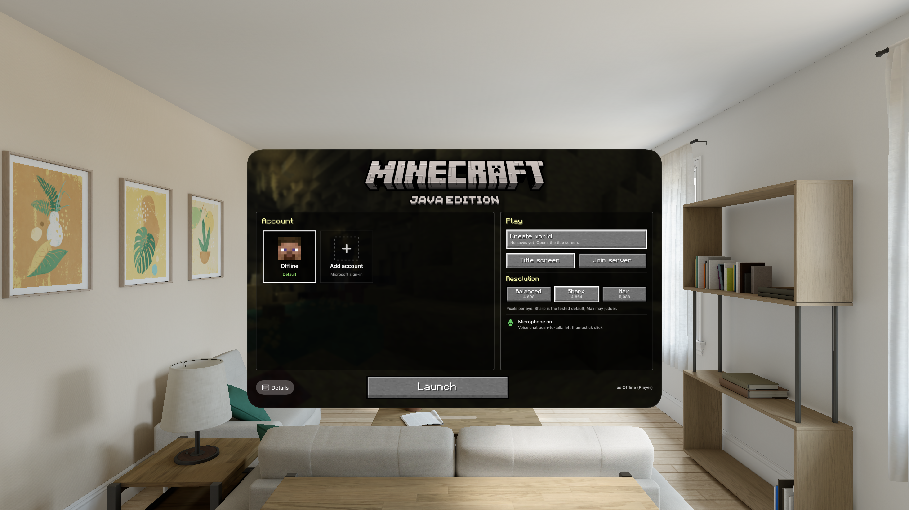

# vivecraft-visionos

Minecraft Java Edition 26.2 and Vivecraft VR, running natively on Apple Vision Pro.

## Klepton

This app runs on [Klepton](https://github.com/shinyquagsire23/Klepton) by [shinyquagsire23](https://github.com/shinyquagsire23). Klepton is the runtime that makes it possible: the visionOS app shell, the OpenXR compositor, and the native-image host. vivecraft-visionos is built on the fork at [github.com/rebelancap/Klepton](https://github.com/rebelancap/Klepton).

## Requirements

- An Apple Vision Pro running visionOS 26 or later.
- Minecraft: Java Edition, owned on a Microsoft account.
- [SideStore](https://sidestore.io) on the headset.

## Ownership

The game stays closed on a device until a Microsoft account that owns Minecraft: Java Edition has signed in on that device once. The launcher says: "Sign in with a Microsoft account that owns Minecraft: Java Edition to unlock this device."

That sign-in is remembered on the device. After it, accounts that do not own the game can play, and so can the Offline profile. Adding those accounts does not unlock a device, and removing the owning account does not lock it again. A release build has no switch that skips this check.

## Install

Add the SideStore source, then install vivecraft-visionos from it. New releases show up there after you pull to refresh.

| Device | Source | Source URL |
| --- | --- | --- |
| Apple Vision Pro | All ports | `https://raw.githubusercontent.com/rebelancap/all-ports/main/apps-visionos.json` |

This app ships for Apple Vision Pro. Its bundle id is `com.rebelancap.vivecraft-visionos`.

In SideStore: **Sources → + → paste the URL**, then install vivecraft-visionos.

On Apple Vision Pro, install SideStore onto the headset first with [iloader](https://github.com/rebelancap/iloader/releases#release-visionos). Then add the source the same way.

SideStore keeps the source JSON it already fetched until you pull to refresh. Its **Refresh** button re-signs the app that is already installed. Pull to refresh on the source to see an update.

You can also download the IPA from the [latest release](../../releases/latest) and install that file with SideStore.

The install is large. The Minecraft client is compiled into the app.

## Controls

Use VR controllers when you have them. A PlayStation VR2 Sense controller, or any controller Vivecraft treats as an Oculus Touch controller, drives Vivecraft's own Touch bindings. Hand tracking is there when a hand has no controller paired. A paired Sense controller takes that hand over.

### Touch controllers

| Input | In the world | In a menu |
| --- | --- | --- |
| Right trigger | Attack / break | Left click |
| Left trigger | Use / place | Click |
| Right squeeze | Next hotbar slot | Middle click |
| Left squeeze | Previous hotbar slot | Shift |
| Both squeezes and both triggers | Interact / climb | |
| Left stick | Walk | |
| Right stick | Snap turn, 45° | Scroll |
| Right A | Jump | Right click |
| Right B, hold | Radial menu | |
| Left X, hold then release | Teleport: aim while held, go on release | |
| Left Y | Inventory | |
| Left menu | Pause | |
| Right stick click | Sneak | |
| Left stick click | Voice chat push-to-talk | |

Vivecraft's own body controls stay on: jump for real, crouch for real, climb for real, touch a hotbar slot with your hand, and reach over your shoulder to change the backpack. Teleport stays available while you stand, together with stick movement. You can walk with the stick or teleport.

### Hand tracking

Pinch your thumb to one fingertip. One finger owns the thumb at a time. The first finger that closes far enough keeps it until you let go. The other fingers read as open while that pinch lasts, because neighbouring fingertips move together.

| Gesture | Left hand | Right hand |
| --- | --- | --- |
| Thumb to **index**, pinch | Use / place | Attack, and click a menu button |
| Thumb to **middle**, tap (under 0.30 s, hand stays put) | Previous hotbar slot | Next hotbar slot |
| Thumb to **middle**, hold still (0.30 s or more) | Climb, and Shift in a menu | Climb |
| Thumb to **middle**, pinch and drag (more than 2.5 cm in the first 0.30 s) | Walk. Push forward to move forward, sideways to strafe | Snap turn left or right. In a menu, push up or down to scroll |
| Thumb to **ring**, pinch | Teleport. Hold to aim with the left hand, release to go | Jump, and right-click in a menu |
| Thumb to **little**, tap | Inventory, when you release | Radial menu, held for as long as you pinch |
| Thumb to **little**, hold 0.8 s or more | Pause | Radial menu, still held |

The drag is a virtual stick planted where the pinch started. Directions use the way your head was facing at that moment. The left hand's forward is the way you are looking. The right hand's up and down is vertical. The first 1.5 cm does nothing. The stick is fully deflected at 7 cm. Let go and it centers.

A pinch that becomes a drag does not also change the hotbar slot. A middle pinch you hold still stays a squeeze, including while you climb, and does not turn into the stick.

Walking follows your head. The app sets Vivecraft's free-move mode to HMD (VR Settings → Locomotion → Free Move Type → HMD).

## Launcher

The window before the game has three choices.

**Account.** Add a Microsoft account, or pick Offline. Add account shows a code. Open the link on a phone or a computer and enter the code. The card you select is the one that launches, and it becomes the default. Each account has its own worlds.

An account that owns Java Edition is labeled Microsoft. An account that does not own it is labeled Offline and plays under that name. The Offline card plays on this device and does not join servers. Servers need a Microsoft account that owns the game.

**Play.**

- **Continue** loads the newest world on the selected account. It is off when that account has no worlds.
- **Title screen** opens the Minecraft title screen.
- **Join server** asks for `host` or `host:port`, then connects there.

**Resolution.** Pixels per eye.

| Choice | Pixels per eye |
| --- | --- |
| Balanced | 4608 |
| Sharp | 4864 |
| Max | 5088 |

Sharp is the default. Max can judder.

The window asks for the microphone before Launch. Voice chat needs that permission. On a controller, push-to-talk is left stick click. **Details** opens the boot log. **Launch** starts the game.

## Mods

These mods are compiled into the app. They are part of the native image, so they are present on every launch.

| Mod | Version | License | Upstream |
| --- | --- | --- | --- |
| Vivecraft | 26.2-1.3.15 | LGPLv3 | https://github.com/Vivecraft/VivecraftMod |
| Sodium | 0.9.2+mc26.2 | Polyform Shield 1.0.0 | https://github.com/CaffeineMC/sodium |
| Lithium | 0.25.3+mc26.2 | LGPL-3.0-only | https://github.com/CaffeineMC/lithium-fabric |
| Fabric API | 0.161.0+26.2 | Apache-2.0 | https://github.com/FabricMC/fabric |
| Simple Voice Chat | 2.6.24+26.2 | All Rights Reserved | https://github.com/henkelmax/simple-voice-chat |
| Cloth Config | 26.2.155 | LGPLv3 | https://github.com/shedaniel/ClothConfig |
| Entity Culling | 1.11.3 | tr7zw Protective License | https://github.com/tr7zw/EntityCulling |
| FerriteCore | 9.0.0 | MIT | https://github.com/malte0811/FerriteCore |
| ImmediatelyFast | 1.16.5+26.2 | LGPL-3.0-or-later | https://github.com/RaphiMC/ImmediatelyFast |
| Krypton | 0.3.1 | LGPL-3.0 | https://github.com/astei/krypton |
| More Culling | 1.8.1 | GPL-3.0-only | https://github.com/fxmorin/moreculling |
| BadOptimizations | 2.4.1 | MIT | https://github.com/imthosea/BadOptimizations |
| Better Biome Blend | 1.4.0 | LGPL-3.0 | https://github.com/FionaTheMortal/better-biome-blend |

Sodium 0.9.2 is Polyform Shield 1.0.0. The license text is [LICENSES/Polyform-Shield-1.0.0.md](LICENSES/Polyform-Shield-1.0.0.md), copied from the jar, and the same text ships in the IPA. The terms are also at https://polyformproject.org/licenses/shield/1.0.0.

Fabric Loader 0.19.5 (Apache-2.0) loads these mods. Libraries that ride along with them are listed in [THIRD-PARTY.md](THIRD-PARTY.md).

## Building from source

The recipe is [BUILDING.md](BUILDING.md). You need an Apple Silicon Mac, Xcode 27 with the visionOS SDK, GraalVM JDK 25, and about 40 GB free. The Minecraft client and the mod jars are downloaded during the build. They are hash-checked. They are not stored in git. Owning the game is what the launcher checks when you play.

## Legal

vivecraft-visionos is not affiliated with Mojang or Microsoft.

The IPA contains the Minecraft client compiled ahead of time. visionOS has no JIT, so the client and the mods are machine code inside the app. That is why the ownership gate is there: the app runs on a device only after an account that owns Minecraft: Java Edition has signed in on it.

The client and the assets stay under the [Minecraft EULA](https://aka.ms/MinecraftEULA) and the [Microsoft Services Agreement](https://www.microsoft.com/msa). A build downloads them from Mojang. Git does not contain them.

Vivecraft, Lithium, ImmediatelyFast, Better Biome Blend, Cloth Config, night-config, PojavLauncherTeam's LTW, and LAME (a codec inside Simple Voice Chat) are LGPL. The corresponding source for the changes in this project is this repository: the patches, the build scripts, and the upstream pins in [THIRD-PARTY.md](THIRD-PARTY.md). You rebuild the image with your own Minecraft client.

Sodium 0.9.2 is Polyform Shield 1.0.0, which is a different license from the LGPL. The text is in this repo and in the IPA.

Every other component, with its version and license, is in [THIRD-PARTY.md](THIRD-PARTY.md).

## Credits

- **[Klepton](https://github.com/shinyquagsire23/Klepton)** by shinyquagsire23. The runtime. This port tracks the fork [rebelancap/Klepton](https://github.com/rebelancap/Klepton). MIT.
- **[Vivecraft](https://github.com/Vivecraft/VivecraftMod)** (and Minecrift). LGPLv3. https://modrinth.com/mod/vivecraft
- **[QuestCraft](https://github.com/QuestCraftPlusPlus/QuestCraft)** and its OpenXR fork of Vivecraft, [QuestCraftPlusPlus/VivecraftMod](https://github.com/QuestCraftPlusPlus/VivecraftMod). The Touch bindings follow that fork.
- **[Fabric](https://github.com/FabricMC/fabric)** and [Fabric Loader](https://github.com/FabricMC/fabric-loader). Apache-2.0.
- **[Sodium](https://github.com/CaffeineMC/sodium)**. Polyform Shield 1.0.0.
- **[Lithium](https://github.com/CaffeineMC/lithium-fabric)**. LGPL-3.0-only.
- **[Simple Voice Chat](https://github.com/henkelmax/simple-voice-chat)** by Max Henkel. All Rights Reserved. https://modrepo.de/minecraft/voicechat/overview
- **[Cloth Config](https://github.com/shedaniel/ClothConfig)**. LGPLv3.
- **[Entity Culling](https://github.com/tr7zw/EntityCulling)** by tr7zw. tr7zw Protective License.
- **[FerriteCore](https://github.com/malte0811/FerriteCore)**. MIT.
- **[ImmediatelyFast](https://github.com/RaphiMC/ImmediatelyFast)**. LGPL-3.0-or-later.
- **[Krypton](https://github.com/astei/krypton)**. LGPL-3.0. It includes [Velocity](https://github.com/PaperMC/Velocity) `velocity-native`, which is GPL-3.0.
- **[More Culling](https://github.com/fxmorin/moreculling)**. GPL-3.0-only.
- **[BadOptimizations](https://github.com/imthosea/BadOptimizations)**. MIT.
- **[Better Biome Blend](https://github.com/FionaTheMortal/better-biome-blend)**. LGPL-3.0.
- **[ANGLE](https://chromium.googlesource.com/angle/angle)**. BSD-3-Clause. The GL implementation.
- **[LWJGL](https://github.com/LWJGL/lwjgl3)**. BSD-3-Clause.
- **[GraalVM](https://www.graalvm.org/)**. The native image is built with Oracle GraalVM under the [GraalVM Free Terms and Conditions](https://www.oracle.com/downloads/licenses/graal-free-license.html).
- **[LTW](https://github.com/PojavLauncherTeam/ltw)** by the PojavLauncher team. LGPL-3.0. The Darwin port of that tiny GL wrapper is in this repo.
